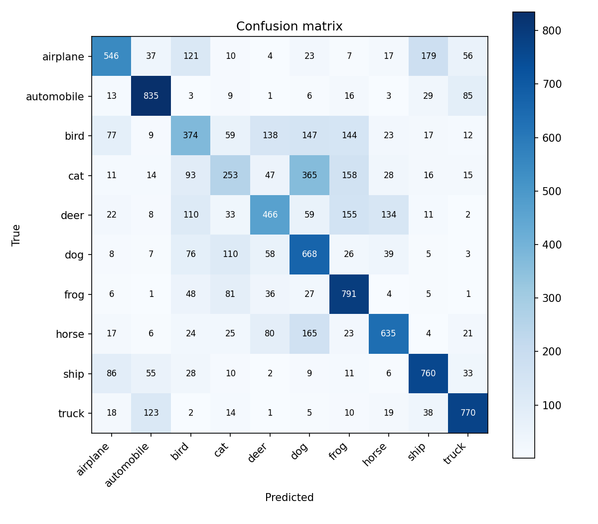
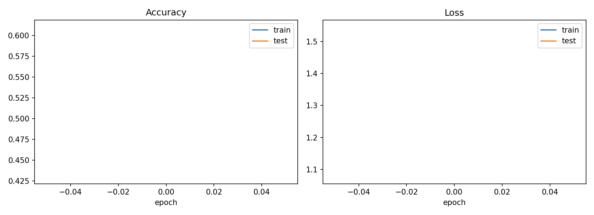

<div align="center">

# CIFAR-10 Image Classifier

### A convolutional neural network built with PyTorch

Train a CNN from scratch, evaluate it on the CIFAR-10 test set, and classify
your own images with top-3 predictions.

<p>
  
  
  
  
</p>

</div>

## Overview

This project implements a compact image-classification pipeline for the
10-class CIFAR-10 dataset:

- Data augmentation with random crops and horizontal flips
- Three convolutional blocks with batch normalization, pooling, and dropout
- Adam optimization with a one-cycle learning-rate schedule
- Classification reports and a confusion matrix for evaluation
- Custom-image prediction with a probability chart
- Automatic CPU/GPU selection through PyTorch

### Supported classes

`airplane` · `automobile` · `bird` · `cat` · `deer` · `dog` · `frog` ·
`horse` · `ship` · `truck`

## Results

The included checkpoint reached **61.0% test accuracy** after a short
5-epoch training run. Longer training can improve the score toward the
project's expected **85–88%** range.

<div align="center">
  
  
</div>

## Quick start

Run these commands from the project directory:

```powershell
python -m venv .venv
.venv\Scripts\Activate.ps1
pip install -r requirements.txt
```

## Usage

### Train

```powershell
python cifar10_classifier.py train --epochs 5
```

### Evaluate

```powershell
python cifar10_classifier.py eval
```

This prints precision, recall, F1-score, and accuracy, then saves
`confusion_matrix.png`.

### Predict a custom image

```powershell
python cifar10_classifier.py predict --image path\to\image.jpg
```

The command prints the three most likely classes and saves `prediction.png`.
For best results, use an image that clearly contains one of the CIFAR-10
classes.

## Project structure

```text
.
├── cifar10_classifier.py  # Training, evaluation, and prediction CLI
├── cifar10_cnn.pth        # Included model checkpoint
├── confusion_matrix.png   # Evaluation visualization
├── training_curves.png    # Training history visualization
├── requirements.txt       # Python dependencies
└── README.md
```

The CIFAR-10 dataset is downloaded automatically into `data/` on the first
training or evaluation run. It is excluded from Git because the download is
too large for GitHub's regular file limit.

## Notes

- Training from scratch on CPU can take several minutes.
- If a CUDA-capable GPU is available, PyTorch uses it automatically.
- Model outputs are written to the project directory.

## License

This repository is an educational machine-learning project. The CIFAR-10
dataset is provided by the University of Toronto and follows its own terms.
